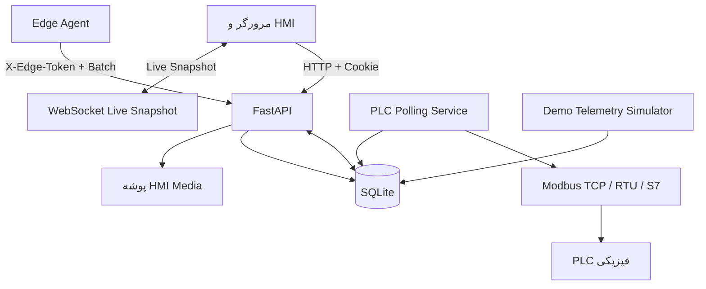

# معماری کلان SCADA_New

## ۱. هدف و محدوده

SCADA_New یک برنامه‌ی یکپارچه‌ی وب برای عملیات و پایش کارخانه است. در نسخه‌ی فعلی، سامانه هم رابط کاربری فارسی RTL دارد و هم بک‌اند مستقل برای احراز هویت، نگهداری رکوردها، تله‌متری، PLC، Edge و گردش‌های کاری.

این سامانه را نباید با PLC ایمنی یا سیستم کنترل قطعی ماشین یکی دانست. وجود Driver ارتباطی به‌تنهایی به معنی راه‌اندازی یا Commissioning موفق یک خط تولید نیست.

## ۲. اجزای اصلی

| بخش | فناوری/مسیر | مسئولیت |
|---|---|---|
| رابط کاربری | HTML، CSS، JavaScript ES Modules | صفحه‌ها، فرم‌ها، HMI و نمایش داده |
| مسیریابی | `src/app/router.js` و Hash URL | انتخاب ماژول بر اساس مسیر `#/...` |
| Store سمت مرورگر | `src/services/demo-store.js` | بارگیری Snapshot سرور و نگهداری وضعیت جاری UI |
| API Client | `src/services/api-client.js` | درخواست HTTP، کوکی نشست و WebSocket URL |
| بک‌اند | FastAPI در `backend/app` | احراز هویت، اعتبارسنجی، منطق عملیات و API |
| دیتابیس | SQLite در `backend/data` به‌صورت پیش‌فرض | کاربران، منابع، رویدادها، تله‌متری و گزارش اجرا |
| PLC Drivers | `backend/app/plc_drivers.py` | Modbus TCP، Modbus RTU و Siemens S7 |
| PLC Poller | `backend/app/plc_service.py` | خواندن دوره‌ای PLC و ذخیره‌ی آخرین مقدار/تاریخچه |
| Edge API | `backend/app/routers/edges.py` و Telemetry | ثبت Edge، Heartbeat و دریافت Batch تله‌متری |
| HMI Media | `backend/app/routers/hmi_media.py` | ذخیره‌ی رسانه‌ی HMI روی دیسک و متادیتا در SQLite |

## ۳. دیاگرام سطح بالا



## ۴. مسیر راه‌اندازی بک‌اند

هنگام شروع برنامه در `backend/app/main.py`، چرخه‌ی عمر FastAPI این کارها را انجام می‌دهد:

1. `initialize_schema()`: جدول‌ها و Indexهای لازم را ایجاد می‌کند.
2. `seed_database()`: اگر جدول کاربران خالی باشد، داده‌های نمایشی اولیه را می‌سازد.
3. اگر `SCADA_DEMO_TELEMETRY=true` باشد، Task مولد داده‌ی نمایشی شروع می‌شود.
4. اگر `SCADA_PLC_POLLING_ENABLED=true` باشد، حلقه‌ی Polling PLC شروع می‌شود.
5. هنگام Shutdown، رویداد توقف به Taskها اعلام و Taskهای فعال جمع‌آوری می‌شوند.

فعال بودن حلقه‌ی Polling به معنی Poll شدن همه‌ی PLCها نیست. تنها PLCهای فیزیکی با `enabled=true` و پروتکل شناخته‌شده وارد برنامه‌ی Poll می‌شوند.

## ۵. مسیر جریان داده

### ۵.۱. PLC فیزیکی

```text
PLC
  -> PLC Driver
  -> poll_plc_once()
  -> آخرین مقدار و کیفیت روی payload تگ
  -> telemetry_samples در زمان سررسید history_interval
  -> ارزیابی Ruleهای آلارم
  -> WebSocket Snapshot / Trend / BI
```

- مقدار جاری تگ در payload رکورد همان تگ نیز نگهداری می‌شود.
- نمونه‌های تاریخی در `telemetry_samples` درج می‌شوند.
- در خواندن موفق کیفیت `GOOD` است.
- در خطا کیفیت `BAD` ثبت می‌شود و آخرین مقدار شناخته‌شده پاک نمی‌شود؛ مقدار باید به‌عنوان Stale/نامعتبر تفسیر شود.

### ۵.۲. Edge

```text
Edge Agent
  -> POST /api/telemetry/edge/ingest
  -> اعتبارسنجی توکن و تعلق Factory
  -> اعتبارسنجی نوع داده‌ی Tag
  -> درج telemetry_samples
  -> به‌روزرسانی آخرین مقدار و Heartbeat Edge
```

این API صرفاً داده دریافت می‌کند و نمونه‌ی دریافتی را به فرمان نوشتن PLC تبدیل نمی‌کند.

### ۵.۳. داده‌ی نمایشی

مولد Demo در بک‌اند فقط برای تگ‌های عددی مجاز و قابل‌خواندن، مقدارهای نمایشی تولید می‌کند. منبع‌های `edge:` و `plc:` را بازنویسی نمی‌کند و تگ‌های متصل به PLC با پروتکل فیزیکی را از تولید Demo کنار می‌گذارد.

### ۵.۴. مسیر HMI و Live

مرورگر به `/api/telemetry/ws/live` متصل می‌شود و Snapshot شامل مقدارها، PLCها و آلارم‌ها می‌گیرد. نرخ پیام WebSocket در بک‌اند، بسته به `interval_ms`، یک یا پنج ثانیه است. HMI می‌تواند از نمونه‌های موقت مرورگر برای حالت Live و از API تاریخچه برای بازه‌های تاریخی استفاده کند.

## ۶. مرزهای کسب‌وکار و کنترل صنعتی

موارد زیر در نسخه‌ی فعلی باید از هم تفکیک شوند:

| عملیات | معنی واقعی در نسخه‌ی فعلی |
|---|---|
| Start/Stop Production Run | تغییر وضعیت Workflow تولید در دیتابیس |
| Start/Stop/Complete Batch | تغییر وضعیت رکورد بچ و ثبت رویداد |
| ثبت مقدار تولید | ثبت ورودی اپراتور/رویداد کسب‌وکار |
| ثبت توزین هاپر | ثبت وزن واردشده به‌صورت دستی و با برچسب DEMO |
| ثبت QC | ذخیره‌ی اندازه‌گیری واردشده در فرم |
| Web Tag Write | تغییر رکورد دمو در SQLite؛ بدون نوشتن PLC |
| Physical PLC Write | مسیر جداگانه با چند قفل ایمنی و Read-back |

هیچ‌یک از عملیات Workflow به‌صورت ضمنی موتور، فیدر، لودسل یا ماشین را کنترل نمی‌کند.

## ۷. تفکیک واقعیت، محدودیت و توسعه‌ی آتی

- **پیاده‌سازی‌شده:** FastAPI، SQLite، Session، CRUD منابع، PLC Driverها، Polling، Edge، Telemetry، WebSocket، آلارم، HMI، عملیات تولید/بچ/QC.
- **محدودیت فعلی:** SQLite تنها دیتابیس پیاده‌سازی‌شده است؛ داده‌ی خام تله‌متری رکوردبه‌رکورد ذخیره می‌شود؛ پردازش PLC به Poll و نگاشت Tag محدود است.
- **پیشنهاد آینده:** صف ورودی تله‌متری، جداسازی Historian، سیاست ذخیره‌سازی در سطح Tag، تجمیع و مهاجرت کنترل‌شده به دیتابیس زمان‌محور.

برای جزئیات هر بخش به سند مربوط در [فهرست مستندات](./README.md) مراجعه کن.
