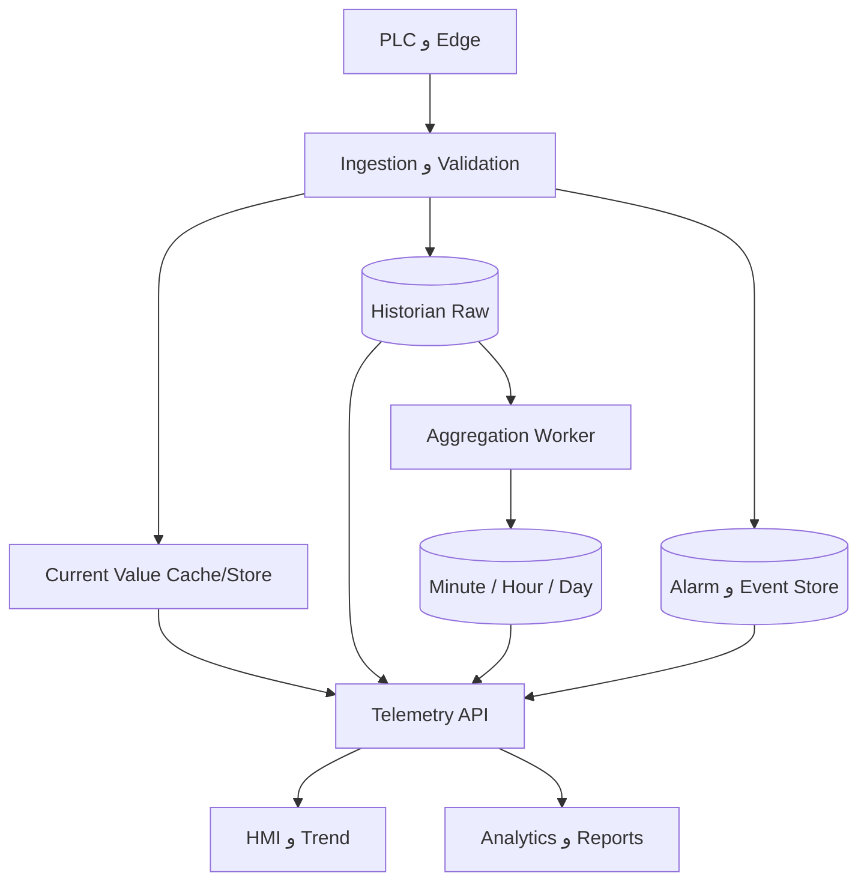

# مقیاس‌پذیری، ذخیره‌سازی و نقشه‌ی راه

## ۱. وضعیت امروز؛ واقعیت کد

در کامیت مرجع این مستندات:
- دیتابیس SQLite است.
- مقدار آخر هر Tag در رکورد Resource و تاریخچه در `telemetry_samples` نگهداری می‌شود.
- هر Sample تاریخچه یک ردیف است.
- Poll PLC از `poll` و ثبت تاریخچه از `history_interval` استفاده می‌کند.
- پریود پیش‌فرض History برابر ۵ ثانیه است.
- Retention پیش‌فرض تله‌متری ۳۰ روز است.
- Edge Ingest همه‌ی نمونه‌های ورودی را ثبت می‌کند؛ Deadband یا Aggregation عمومی در این مسیر وجود ندارد.
- Aggregate دقیقه‌ای/ساعتی/روزانه و TimescaleDB/ClickHouse در مخزن فعلی پیاده‌سازی نشده‌اند.

این سند طرح توسعه است، نه توصیف قابلیت موجود.

## ۲. برآورد نرخ ورودی

تعداد Sample خام در روز:

```text
samples_per_day = tag_count × 86400 / interval_seconds
```

مثال‌ها:

| تعداد Tag | فاصله | Sample در روز |
|---:|---:|---:|
| ۱۰۰۰ | ۱ ثانیه | ۸۶٫۴ میلیون |
| ۱۰۰۰ | ۵ ثانیه | ۱۷٫۲۸ میلیون |
| ۱۰٬۰۰۰ | ۱ ثانیه | ۸۶۴ میلیون |
| ۱۰٬۰۰۰ | ۵ ثانیه | ۱۷۲٫۸ میلیون |

این محاسبه فقط نمونه‌های یک منبع را فرض می‌کند. مقدار واقعی با وضعیت PLCها، Edgeها، نرخ ارسال، BAD Sampleها و تعداد Tagهای فعال تغییر می‌کند.

## ۳. مسئله‌ی واقعی چیست؟

مسئله فقط تعداد رکورد نیست. باید این عوامل را با هم سنجید:
- نرخ ورود Sample بر ثانیه و Burstهای Edge.
- تعداد Tagهای فعال در هر Factory.
- مدت نگهداری داده‌ی خام.
- Queryهای Trend و Analytics هم‌زمان.
- هزینه‌ی Index و نوشتن.
- Backup، WAL، Disk I/O و بازیابی.
- نیاز به وضوح یک‌ثانیه‌ای برای عیب‌یابی در برابر روند ساعتی/روزانه برای گزارش.

SQLite برای شروع ساده و کم‌هزینه است، اما برای بار چندکارخانه‌ای و حجم بالای نوشتن، نیازمند Benchmark و احتمالاً جداسازی Store تاریخچه خواهد بود.

## ۴. سیاست ذخیره‌سازی پیشنهادی در سطح Tag

**پیشنهاد آینده:** مشخصات ذخیره‌سازی به‌جای یک پریود واحد برای تمام Tagها، در هر Tag قابل تعیین باشد.

| Policy پیشنهادی | رفتار |
|---|---|
| `LIVE_ONLY` | فقط آخرین مقدار و Cache لایو؛ بدون History پایدار |
| `PERIODIC` | Sample در بازه‌ی زمانی مشخص |
| `ON_CHANGE` | Sample هنگام تغییر معنادار |
| `EVENT` | ذخیره در لحظه‌ی Trigger/رویداد |
| `DISABLED` | غیرفعال‌بودن کامل ذخیره |

فیلدهای پیشنهادی:
- `storage_mode`
- `sample_interval`
- `deadband_abs` یا `deadband_percent`
- `max_silence_interval`
- `raw_retention_days`
- `aggregate_levels`

این فیلدها در نسخه‌ی فعلی قرارداد فعال و منطق اجرایی کامل ندارند. باید در Schema، اعتبارسنجی، UI و سرویس دریافت داده پیاده‌سازی شوند.

### قاعده‌ی مهم

Deadband به‌تنهایی کافی نیست. برای متغیر مهمی که مقدار آن ثابت می‌ماند، `max_silence_interval` یا Heartbeat نمونه‌برداری لازم است تا قطع ارتباط با ثابت ماندن مقدار اشتباه گرفته نشود.

## ۵. لایه‌های تاریخچه پیشنهادی

| لایه | نوع داده | کاربرد |
|---|---|---|
| Hot Raw | Sample خام با Timestamp و Quality | عیب‌یابی و نمودار دقیق |
| Minute Aggregate | حداقل/حداکثر/میانگین/اولین/آخرین | روندهای میان‌مدت |
| Hour Aggregate | خلاصه‌ی ساعتی | تحلیل شیفت و روز |
| Day Aggregate | خلاصه‌ی روزانه | گزارش ماهانه و سالانه |
| Event Store | آلارم، Trigger و رویدادهای عملیاتی | تاریخچه‌ی رویدادمحور |

نمونه‌ی تجمیع:
- Analog: Min، Max، Avg، First، Last و Sample Count.
- Counter: First، Last، Delta/Consumption و Reset Detection.
- Digital: زمان ON، زمان OFF و تعداد تغییر وضعیت.
- Event: زمان و Payload دقیق؛ نباید به میانگین تبدیل شود.

## ۶. انتخاب دیتابیس برای مرحله‌ی بعد

### مرحله‌ی فعلی

SQLite را برای ادامه‌ی توسعه و محیط Demo حفظ کن؛ ابتدا نرخ ورودی واقعی و محدودیت عملی آن را با Load Test اندازه بگیر.

### گزینه‌ی پیشنهادی برای Historian

PostgreSQL + TimescaleDB گزینه‌ی طبیعی برای ارزیابی مرحله‌ی بعد است:
- ساختار رابطه‌ای برای داده‌ی اصلی و کنترل دسترسی.
- Hypertable و Chunkهای زمانی برای تاریخچه.
- Retention و Aggregateهای زمان‌محور.

این گزینه هنوز در کد فعلی نصب یا استفاده نشده است و مهاجرت باید با طرح Schema، Benchmark، Backup و Rollback همراه باشد.

### گزینه‌ی تحلیل حجیم

ClickHouse می‌تواند برای تحلیل و Queryهای حجیم آینده ارزیابی شود؛ اما نباید بدون نیاز واقعی و معماری ETL/Streaming، از ابتدا بار عملیاتی دوم به پروژه تحمیل کند.

## ۷. معماری هدف پیشنهادی



در این معماری، Latest و Raw و Aggregate سه مفهوم مجزا هستند. این دیاگرام مقصد پیشنهادی است و هنوز معماری جاری برنامه نیست.

## ۸. مراحل مهاجرت بدون شکستن پروژه

1. **اندازه‌گیری:** تعداد Tag، متوسط و Peak Sample/s، حجم روزانه، Latency Query و Disk I/O ثبت شود.
2. **قرارداد داده:** Timestamp، Quality، Source، Factory ID، Tag ID، نوع مقدار و ترتیب داده تعریف و نسخه‌بندی شود.
3. **سیاست Tag:** Storage Mode و بازه‌ها به مدل Tag افزوده و با Default سازگار شوند.
4. **Batch Ingest:** نوشتن گروهی و کنترل Burst Edge طراحی شود.
5. **تجمیع:** Worker مستقل و قابل تکرار برای Minute/Hour/Day ایجاد شود؛ داده‌ی خام پیش از تأیید Aggregate حذف نشود.
6. **جداسازی Historian:** API قرارداد فعلی History را حفظ کند و Backend Store پشت آن قابل تعویض باشد.
7. **مهاجرت آزمایشی:** SQLite و Store جدید در محیط آزمایشی با داده‌ی نمونه مقایسه شوند.
8. **Cutover و Rollback:** مهاجرت با Backup، بررسی شمارش و مقدار، پنجره‌ی توقف و روش بازگشت مستند اجرا شود.

## ۹. معیارهای لازم پیش از انتخاب نهایی

- تعداد کارخانه و Tag فعال
- Sample/s عادی و Peak
- حداکثر Latency برای Live و Trend
- نیاز قانونی/عملیاتی نگهداری Raw
- زمان و حجم Backup
- هزینه‌ی Storage
- تعداد کاربران و Queryهای هم‌زمان
- تحمل قطعی Edge و حداکثر Backlog
- نیاز به Multi-Region یا High Availability

## ۱۰. قواعد ایمنی داده در هر مهاجرت

- هیچ داده‌ای را صرفاً برای سبک‌کردن DB بدون اثبات وجود Aggregate معتبر حذف نکن.
- Quality و Source را هنگام Aggregate حفظ یا در خروجی خلاصه منعکس کن.
- Sample زمان‌دار باید UTC و دارای Timestamp معتبر باشد.
- داده‌های DEMO نباید با داده‌ی GOOD واقعی مخلوط و بی‌برچسب شوند.
- Report/Alarm باید معلوم کند از Raw، Aggregate یا Event استفاده کرده است.
- قبل از تغییر قرارداد API، تست Frontend، HMI، Trend و Report تهیه شود.
